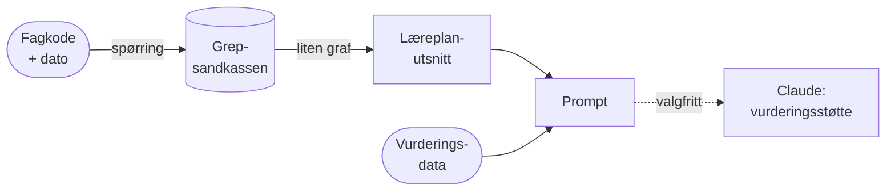

# laereplan-prompt

Dette er et privat initiativ utviklet av Are Mjølsnes med støtte fra Claude Code. Det er ikke et produkt eller en tjeneste fra Utdanningsdirektoratet, og Udir står ikke bak innholdet. Repoet er et eksperiment som skal vise hva som blir mulig når læreplanene i Grep er tilgjengelige som lenkede data.

Spørsmålet er enkelt: Hvis en lærer vil bruke en språkmodell som støtte i vurderingsarbeidet, hvordan sikrer vi at modellen leser elevens resultater mot riktig læreplan? Det er ikke nok å lime inn et kompetansemål. Modellen må vite hvilken versjon av læreplanen som gjaldt da eleven ble vurdert, hva verbene i målet betyr, hvilke kjerneelementer målet hører til og hva det bygger på fra tidligere trinn.

Med repoet kan du:

- hente et presist læreplanutsnitt for en fagkode på en gitt dato, som Markdown eller Turtle;
- bygge en ferdig prompt av utsnittet og vurderingsdata, og lese, lagre eller dele den;
- sende prompten til Claude og se hva slags vurderingsstøtte modellen gir, og hva det koster;
- bruke det som utgangspunkt for en demo eller en diskusjon om AI, læreplaner og vurdering.

Kort sagt: fra fagkode til AI-prompt. Skriptet henter riktig del av læreplanen fra Grep og setter den sammen med vurderingsdata til en prompt for en språkmodell.

> **Bygger på Grep-sandkassen.** laereplan-prompt er en anvendelse av
> [Grep-sandkassen](https://github.com/aremjolsnes/grep-jena-fuseki/blob/main/docs/bruk.md), et åpent
> SPARQL-endepunkt med Grep-dataene. Samlet, med meny, kan dokumentasjonen for begge leses i
> [SPARQL-workbenchen](https://sparql.mjolne.com/dokumentasjon?endepunkt=Sandkassen&side=laereplan-prompt).



Det viktigste skjer i første ledd: spørringen velger den læreplanen og de kompetansemålene som **gjaldt på datoen**, og tar med det en modell trenger for å lese målene riktig:

- fagets relevans, kjerneelementer og vurderingsordning;
- hva de grunnleggende ferdighetene og tverrfaglige temaene betyr i faget (bare de målene peker på);
- Udirs forklaring av verbene i målene;
- forklaring av målet («didaktisk støtte»), der den finnes;
- mål fra tidligere trinn som målet bygger på, der det er registrert.

Spørringen ligger i [grep-jena-fuseki](https://github.com/aremjolsnes/grep-jena-fuseki/blob/main/docs/eksempler/laereplanutsnitt.rq) og hentes derfra, så det bare finnes én kopi.

## Kom i gang

```bash
python -m venv venv
venv\Scripts\activate        # Windows (macOS/Linux: source venv/bin/activate)
pip install -r requirements.txt
```

### API-nøkkel (bare for `--kall`)

Uten `--kall` trengs ingen nøkkel. Med `--kall` leser skriptet nøkkelen fra miljøvariabelen `ANTHROPIC_API_KEY`. Lag en nøkkel på [console.anthropic.com](https://console.anthropic.com/settings/keys) og sett den:

```powershell
# Windows (PowerShell), bare for denne terminalen
$env:ANTHROPIC_API_KEY = "sk-ant-..."

# Windows, permanent (åpne en ny terminal etterpå)
setx ANTHROPIC_API_KEY "sk-ant-..."
```

```bash
# macOS/Linux (legg linja i ~/.zshrc eller ~/.bashrc for å gjøre den permanent)
export ANTHROPIC_API_KEY="sk-ant-..."
```

Sjekk at den er satt: `python -c "import os;print(bool(os.environ.get('ANTHROPIC_API_KEY')))"`. Legg aldri nøkkelen i en fil som sjekkes inn i git.

## Bruk

```bash
# Vis prompten for et oppdiktet eksempel (ingen API-nøkkel trengs)
python lag_prompt.py --vurdering eksempler/mat0015-elev-a.json

# Bare læreplanutsnittet for en fagkode, på en bestemt dato
python lag_prompt.py MAT0015 --dato 2025-03-01

# Utsnittet som Turtle i stedet for Markdown
python lag_prompt.py MAT0015 --format turtle

# Send prompten til Claude og vis svaret (krever ANTHROPIC_API_KEY)
python lag_prompt.py --vurdering eksempler/mat0015-elev-a.json --kall

# Samme, men med en billigere modell
python lag_prompt.py --vurdering eksempler/mat0015-elev-a.json --kall --modell sonnet
python lag_prompt.py --vurdering eksempler/mat0015-elev-a.json --kall --modell haiku
```

### Velge modell

`--modell` bestemmer hvilken Claude-modell `--kall` bruker:

| `--modell` | Modell | Pris per kall (ca.) |
|---|---|---|
| `opus` (standard) | Claude Opus 5.5 | 0,13 USD |
| `sonnet` | Claude Sonnet 5.5 | 0,05 USD |
| `haiku` | Claude Haiku 5.5 | under 0,005 USD |

Sonnet ga nesten like gode svar som Opus i testen. Haiku var brukbar, men mindre presis. Se [docs/kostnad.md](docs/kostnad.md#test-av-billigere-modeller-12112026).

Kostnaden for kallet står nederst i utskriften. Hvis sikkerhetsfilteret avslår et kall til Opus eller Sonnet, prøver API-et en annen modell i samme kall. Haiku har ikke den muligheten.

Andre valg: `--modell` velger modell (se over), `--lagre fil.txt` skriver prompten til fil, `--effort` styrer hvor grundig modellen tenker (standard `medium`), `--rq` peker på en lokal kopi av spørringen. Endepunktet kan byttes med miljøvariabelen `GREP_SPARQL_URL`.

Ett kall med `--kall` koster rundt 0,13 USD med Opus 5.5, som er standard. Se [docs/kostnad.md](docs/kostnad.md) for hva det blir for en klasse, en skole og hele landet, og hvordan prisen kan bli lavere.

Datoen er vurderingsdatoen i vurderingsfila hvis den finnes, ellers dagens dato. Det betyr noe: matematikk 1.–10. byttet fra MAT01-05 til MAT01-06 1. august 2026, så en vurdering fra våren 2026 skal leses mot den gamle versjonen.

## Filer

| Fil | Innhold |
|---|---|
| `lag_prompt.py` | Henter utsnittet, gjør grafen om til Markdown, bygger prompten, sender den eventuelt til Claude |
| `maler/system.md` | Systemprompten: rollen og reglene modellen skal følge |
| `maler/oppgave.md` | Brukerprompten, med plass til `{utsnitt}` og `{vurdering}` |
| `eksempler/*.json` | Oppdiktede vurderingsdata: matematikk 10. trinn, naturfag 10. trinn og matematikk 1T |
| `demo/` | Ferdige prompter (og svar) som reserve under demo |
| [`docs/demomanus.md`](docs/demomanus.md) | Manus for en demo på ca. 30 minutter |
| [`docs/oeving.md`](docs/oeving.md) | Trinn for trinn: hva du gjør og hvor (VS Code, nettleser) i hvert punkt i demoen |
| [`docs/kostnad.md`](docs/kostnad.md) | Overslag over hva `--kall` koster per elev, skole og land |

## Vurderingsdata

Formatet er bare et eksempel. Det som betyr noe, er at hver vurdering viser til kompetansemål med kode (`KM…`). Skriptet sier fra hvis en kode ikke finnes i utsnittet, for eksempel fordi læreplanen har fått en ny versjon.

```json
{
  "fagkode": "MAT0015",
  "vurderingsdato": "2026-11-01",
  "vurderinger": [
    { "dato": "2026-09-05", "type": "skriftlig prøve", "kompetansemaal": ["KM13328"],
      "resultat": "11 av 20 poeng", "kommentar": "…" }
  ]
}
```

**Bruk ikke ekte elevdata** med `--kall` uten at behandlingsgrunnlag, databehandleravtale og personvern er avklart.

## Begrensninger

- Bare læreplaner i LK20. Fagkoder uten LK20-læreplan (for eksempel privatskolekoder og UPF) gir tomt utsnitt.
- `bygger-paa` er registrert for mange læreplaner, også i yrkesfag, men ikke for alle. 15 gjeldende læreplaner peker på mål i læreplaner som ikke gjelder lenger (for eksempel 1T → MAT01-05, historie → SAF01-04).
- Forklaring av målene finnes for rundt 400 mål i 77 læreplaner, flest i matematikk og naturfag.
- Grep-sandkassen er et eksperiment og ikke en tjeneste fra Utdanningsdirektoratet.
